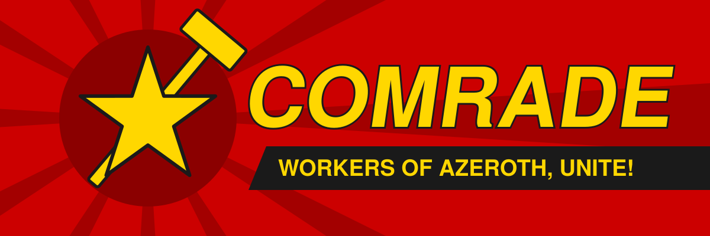

  
  
  

<b>★ The means of role-play now belong to the people. ★</b>

# ☭ Comrade

A World of Warcraft Forever addon for communist role-play. Everything it sends is seen by other players.

## ★ Install

Copy this folder into `World of Warcraft/_forever_/Interface/AddOns/Comrade` and restart the game.

## ★ What it sends

| When | Where | Example |
|---|---|---|
| You level up | emote | *Calf Marx has seized more of the means of production.* |
| A trade opens | whisper to your trade partner | Property is theft, comrade. Let this exchange be between equals, not owners. |
| You join a group | party or raid | Workers of Azeroth, unite! |
| You gain a gold or more at once | emote | *Calf Marx accepts the gold on behalf of the people.* |
| Every 15 to 30 minutes, out of combat, not away | emote | *Calf Marx hums The Internationale.* |

Each trigger also plays an animated built-in emote: flex on level up, bow on trade, salute on joining a group and shy on money. Random emotes have none by default. Outside dungeons the game only sends a custom emote from your own key press. So a waiting line shows above the chat with a hammer icon, and goes out with your next action bar key press out of combat. That press still uses your ability as normal. Built-in emotes still play on their own. Random emotes pause while you are away. Each trigger fires at most once every five minutes. Every trigger, the cooldown, the money threshold and the random interval can be changed under Options → AddOns → Comrade. The messages themselves are edited under Comrade → Lines, one per line, with a reset back to the defaults.

## ★ Commands

| Command | Does |
|---|---|
| `/comrade` | open the settings |
| `/comrade on` / `/comrade off` | start or pause everything |
| `/comrade now` | queue a random emote for your next ability |
